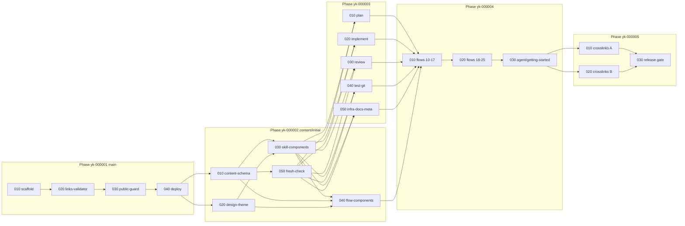

# Task Dependency Graph

**Next PHASE (yk): `000006`** — authoritative starting point for the next `yk`-initials `ywc-task-generator` batch. Read this line first; do not re-derive by scanning when it is present. After allocating a new batch, update this line to `highest allocated PHASE + 1`.

- Source spec: `docs/specification/` (README, 01–07), `docs/mission.md`, `docs/tech-stack.md`, `docs/design/design-system.md`
- Language: ko / Granularity: llm / Generated: 2026-10-28
- Branch 정책 (R-RELEASE): Phase yk-000001 은 `main` 에 병합한다. 병합 후 owner 가 main 에서 `content/initial` 을 만들고, Phase yk-000002–000005 는 모두 `content/initial` 을 base 로 한다. 첫 공개는 `yk-000005-030` 의 마지막 단계(`content/initial` → main 병합)다.

## Phase yk-000001 — Foundation (base: main)
- `yk-000001-010-lib-astro-starlight-scaffold` → (root)
- `yk-000001-020-lib-starlight-links-validator` → depends on `yk-000001-010`
- `yk-000001-030-infra-public-guard` → depends on `yk-000001-020`
- `yk-000001-040-infra-github-actions-deploy` → depends on `yk-000001-030`

## Phase yk-000002 — Site framework (base: content/initial)
- `yk-000002-010-domain-content-schema` → depends on Phase yk-000001
- `yk-000002-020-ui-design-theme` → depends on Phase yk-000001
- `yk-000002-030-ui-skill-components` → depends on `yk-000002-010`, `yk-000002-020`
- `yk-000002-040-ui-flow-components` → depends on `yk-000002-010`, `yk-000002-020`, `yk-000002-030`
- `yk-000002-050-domain-fresh-check` → depends on `yk-000002-010`

## Phase yk-000003 — Skill pages 1st pass (base: content/initial)
- `yk-000003-010-ui-skill-pages-plan` → depends on `yk-000002-030`, `yk-000002-050`
- `yk-000003-020-ui-skill-pages-implement` → depends on `yk-000002-030`, `yk-000002-050`
- `yk-000003-030-ui-skill-pages-review` → depends on `yk-000002-030`, `yk-000002-050`
- `yk-000003-040-ui-skill-pages-test-git` → depends on `yk-000002-030`, `yk-000002-050`
- `yk-000003-050-ui-skill-pages-infra-docs-meta` → depends on `yk-000002-030`, `yk-000002-050`

## Phase yk-000004 — Flow, agent, guide pages (base: content/initial)
- `yk-000004-010-ui-flow-pages-10-17` → depends on Phase yk-000003, `yk-000002-040`
- `yk-000004-020-ui-flow-pages-18-25` → depends on `yk-000004-010`
- `yk-000004-030-ui-agent-getting-started-pages` → depends on `yk-000004-020`

## Phase yk-000005 — Crosslinks 2nd pass and first release (base: content/initial → main)
- `yk-000005-010-ui-skill-crosslinks-plan-to-review` → depends on Phase yk-000004
- `yk-000005-020-ui-skill-crosslinks-test-to-meta` → depends on Phase yk-000004
- `yk-000005-030-test-first-release-gate` → depends on `yk-000005-010`, `yk-000005-020`

## Parallel Execution Notes
- Phase yk-000001 is strictly sequential: `package.json` / `package-lock.json` / `astro.config.mjs` are shared by 010 → 020 → 030, and 040 consumes the guard contract.
- Gate: after Phase yk-000001 merges to main, the owner creates `content/initial` from main and completes the one-time manual settings (Pages source, `GUARD_SENSITIVE_WORDS` secret, environment branch rule) described in `yk-000001-040`.
- Phase yk-000002 initial ready set: `yk-000002-010`, `yk-000002-020` (disjoint files; 020 touches only `customCss`/`expressiveCode`/`head` in `astro.config.mjs`).
- After `yk-000002-010` merges: `yk-000002-050` is runnable (does not depend on theme).
- After 010 and 020 merge: `yk-000002-030`; after 030 merges: `yk-000002-040` (both edit `components` in `astro.config.mjs`, so they must not run together).
- Phase yk-000003: all five tasks can run in parallel (disjoint `src/content/docs/skills/<skill>.mdx` files and disjoint `.fact-memos/skills/` memos). Run them in parallel only when owner `excludedOptions` rulings are available.
- Phase yk-000004 is sequential: 020 edits the 관련 흐름 sections of flow pages 10–17, and 030's home entry list needs all 16 flow pages.
- Phase yk-000005: 010 and 020 run in parallel (disjoint skill files); 030 runs after both and ends with the main merge (owner approval).

## Open Questions (No-AC, not emitted as tasks)
- ~~**OQ-T1**: Header 의 `ywc skills · N` 표시~~ → 결정 (2026-10-28, owner): 넣지 않는다. Header 는 Starlight 기본 + CSS 로 두며 `Header` override task 는 만들지 않는다 (design-system Components 표 반영).

## Visual Dependency Graph (Optional)

